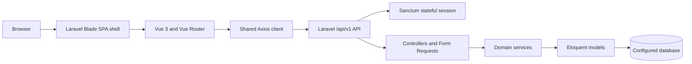

# Planora Architecture

## Application shape

Planora is a Laravel 10 application with a Vue 3 single-page frontend. Laravel serves the Blade SPA shell and versioned JSON API; Vue Router loads pages into separate Auth, User, and Admin layouts. Vite builds the frontend assets.

## Backend

- `routes/web.php` serves the SPA shell and frontend fallback; API routes are mounted through `routes/api.php` and registered in `routes/api/v1.php`.
- Controllers coordinate HTTP requests and responses. Form Requests validate and authorize inputs; JSON Resources serialize API results.
- Models and migrations describe Users, Categories, Projects, Tasks, authentication records, and activity data. Services hold reusable category, task, project, account, and authentication operations.
- API authentication uses Sanctum's stateful session middleware. Admin Project and Task endpoints require an active Admin; User Project and Task endpoints require an active User and apply server-side record scoping.
- User Projects are scoped by the Project owner assignment. Project Task queries also require that the User owns or is assigned to each returned Task.
- Categories are managed through an Admin-only API and a separate read-only User catalog. Category foreign keys on Projects and Tasks are nullable; archiving retains existing associations. User Category details scope related Projects to their owner and Tasks to their owner or assignee.

## Frontend

- `resources/views/welcome.blade.php` is the SPA shell; `resources/js/app.js` mounts Vue, Pinia, and Vue Router.
- `resources/js/router/routes.js` declares lazy-loaded public, Auth, User, Admin, and error pages. `resources/js/router/guards.js` checks session identity and role for navigation.
- Auth state and API helpers live under `resources/js/features/auth/`; shared Axios configuration is in `resources/js/shared/services/api.js`.
- User and Admin Task features are separated under `resources/js/features/tasks/`. Admin Project components and API helpers are in `resources/js/features/projects/admin/`; User Project API helpers are in `resources/js/features/projects/user/`.
- Categories use `resources/js/features/categories/admin/`, `user/`, and `shared/` for their active components, composables, and API services. Route pages live under `resources/js/pages/admin/categories/` and `resources/js/pages/app/categories/`.
- Shared layouts and components live under `resources/js/layouts/` and `resources/js/shared/`; styles and tokens live under `resources/css/`.
- `resources/css/app.css` is the single global stylesheet entry and loads `tokens/index.css`, `base/reset.css`, then `base/typography.css`. Layout styles are in `layouts/`, reusable styles in `components/`, Category styles in `features/categories/{admin,shared,user}/`, and other route styles remain in `pages/`. Vue SFC stylesheet imports preserve lazy loading for route and component styles.

## Trust boundaries

Vue route guards provide navigation behavior only. Authentication, active-account checks, role restrictions, Project ownership, Task ownership/assignment, validation, and database scoping are enforced by Laravel middleware, policies, Form Requests, and services. API authorization must not depend on client-side route visibility.

Roles are stored on the User record (`admin`, `moderator`, or `user`). Moderator permissions are stored as JSON and checked by the user-management authorization layer. The current Vue Admin layout is restricted to admins, so moderator backend permissions do not provide access to that SPA layout.

## Current implementation boundary

Database-backed User/Admin account, Task, and Project workflows are implemented. Categories are shared by Projects and Tasks: Admin manages the catalog, while Users can browse active categories and see only related records they can already access. Calendar, tags, reports, notifications, settings, and several other routed screens remain partial or scaffolded; a route or component alone does not imply a complete backend workflow. See [the API documentation](docs/API_DOCUMENTATION.md), [database design](docs/DATABASE_DESIGN.md), and [development roadmap](docs/DEVELOPMENT_ROADMAP.md) for current scope.
