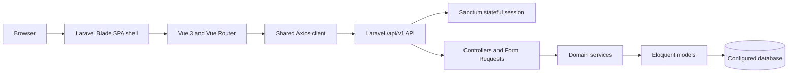

# Planora architecture

## Application shape

Planora is a Laravel 10 application with a Vue 3 single-page frontend. Laravel serves the Blade SPA shell and versioned JSON API; Vue Router loads pages into separate Auth, User, and Admin layouts. Vite builds the frontend assets.

## Backend

- `routes/web.php` serves the SPA shell and frontend fallback. It also registers the configured administrator entry path; that path is not a Vue route. API routes are mounted through `routes/api.php` and registered in `routes/api/v1.php`.
- Controllers coordinate HTTP requests and responses. Form Requests validate and authorize inputs; JSON Resources serialize API results.
- Models and migrations describe Users, Categories, Projects, Tasks, notifications, authentication records, and activity data. Services hold reusable domain operations.
- API authentication uses Sanctum's stateful session middleware. Admin-only operations include Category changes, full Project and Task management, Reports CSV export, Settings, and Moderator permission assignment. Moderators can access only capabilities individually assigned from the fixed permission catalog, including permitted User, Activity, Category, Project, Task, and report views; User, Project, and Task status changes require the corresponding additional status permission. User Project and Task endpoints require an active User and apply server-side record scoping.
- User Projects are scoped by the Project owner assignment. Project Task queries also require that the User owns or is assigned to each returned Task.
- Category changes use Admin-only API operations; Moderators with `categories.view` can access read-only Admin Category views, and Users have a separate active-only catalog. Category foreign keys on Projects and Tasks are nullable; archiving retains existing associations. User Category details scope related Projects to their owner and Tasks to their owner or assignee.
- Maintenance enforcement is split between Laravel's global maintenance gate and three Planora scopes. Scope state and visitor copy are stored in a lock-protected file under `storage/framework`; middleware enforces scopes on matching web and API routes.
- Notifications are stored per recipient in `user_notifications`. A service creates task and administrative event notifications, and authenticated User/Admin APIs return recipient-scoped history and read-state mutations.

## Frontend

- `resources/views/welcome.blade.php` is the SPA shell; `resources/js/app.js` mounts Vue, Pinia, and Vue Router.
- `resources/js/router/routes.js` declares lazy-loaded public, Auth, User, Admin, and error pages. `resources/js/router/guards.js` checks session identity, role, supported Moderator permissions, and maintenance status for navigation.
- The administrator sign-in screen is selected by a server-rendered shell marker at the configured entry path. The path itself is not exposed as a frontend route.
- Auth state and API helpers live under `resources/js/features/auth/`; shared Axios configuration is in `resources/js/shared/services/api.js`.
- Notification state and views live under `resources/js/features/notifications/` and are shared by the User and Admin notification pages and header preview.
- Appearance preferences support account-specific settings and a separate guest theme persisted in browser storage and a cookie for server-rendered pages.
- One authenticated `/profile` route serves User, Moderator, and Admin accounts. A thin profile layout selects the existing User or Admin workspace shell while all roles share the same profile page and feature components in `resources/js/features/profile/`.
- User and Admin Task features are separated under `resources/js/features/tasks/`. Admin Project components and API helpers are in `resources/js/features/projects/admin/`; User Project API helpers are in `resources/js/features/projects/user/`.
- Categories use `resources/js/features/categories/admin/`, `user/`, and `shared/` for their active components, composables, and API services. Route pages live under `resources/js/pages/admin/categories/` and `resources/js/pages/app/categories/`.
- Shared layouts and components live under `resources/js/layouts/` and `resources/js/shared/`; styles and tokens live under `resources/css/`.
- `resources/css/app.css` is the single global stylesheet entry and loads `tokens/index.css`, `base/reset.css`, then `base/typography.css`. Layout styles are in `layouts/`, reusable styles in `components/`, Category styles in `features/categories/{admin,shared,user}/`, and other route styles remain in `pages/`. Vue SFC stylesheet imports preserve lazy loading for route and component styles.

## Trust boundaries

Vue route guards provide navigation behavior only. Authentication, active-account checks, role restrictions, Project ownership, Task ownership/assignment, validation, and database scoping are enforced by Laravel middleware, policies, Form Requests, and services. API authorization must not depend on client-side route visibility.

Roles are stored on the User record (`admin`, `moderator`, or `user`). The fixed Moderator permission catalog is defined in `config/user_management.php`; per-account assignments are stored as JSON and checked by Laravel policies and middleware. The Moderator role alone grants no module permissions. Admin remains unrestricted, and only Admin can manage Moderator assignments. Status permissions require their corresponding view permissions. Dashboard section flags for Users, Activity, Categories, Projects, Tasks, and Reports follow the viewer's grants; metric data is returned for the first five sections, while Reports uses its separate endpoints. Frontend route checks mirror the supported Moderator destinations without replacing backend authorization; see [authentication and security](docs/AUTHENTICATION_SECURITY.md) for the permission meanings.

The administrator entry path is a server-side routing secret, not an authentication credential or authorization mechanism. The web login still validates the account's role, active status, and verified email, uses session and CSRF middleware, and applies login throttling. The path is not included in Vue routes or public API responses.

## Current implementation boundary

Database-backed Admin account, Task, Project, Category, Reports & Analytics, Activity Logs, Settings, Dashboard, Roles & Permissions, maintenance controls, and notification workflows are implemented. The shared User, Moderator, and Admin My Profile page supports personal details, profile photo management, and password changes. Admin Task deletion is recoverable; Project deletion remains permanent and detaches linked Tasks. Categories are shared by Projects and Tasks: Admin manages the catalog, while Users can browse active categories and see only related records they can already access. User notifications include task assignment, status, and due-soon events; Calendar, Tags, and some productivity and settings screens remain partial or scaffolded. See [API documentation](docs/API_DOCUMENTATION.md), [database design](docs/DATABASE_DESIGN.md), and [development roadmap](docs/DEVELOPMENT_ROADMAP.md) for current scope.
