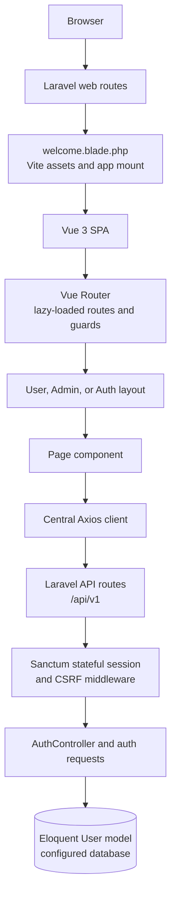

# Planora

**Plan your day. Shape your future.**

Planora is an in-development task planning and productivity application built with Laravel and Vue 3. It combines a Laravel web/API backend with a Vue single-page application (SPA), with separate User and Admin interface areas.

The repository currently establishes the application shell, responsive dashboard prototypes, and a small session-authentication API. Most task, project, reporting, and account-management screens are structural placeholders; they are not yet end-to-end product features.

## Project Overview

The Laravel web routes serve one Blade document as the Vue mount point. Vue Router renders the appropriate authentication, User, Admin, or error view inside the SPA. User and Admin pages have separate layouts, headers, and navigation. The frontend uses Axios to call Laravel's versioned API; at present, only a small set of authentication and current-user endpoints is registered.

The two dashboards are visual prototypes populated with static demonstration data. They are useful for evaluating layout and styling, but their counts and activity do not represent database records.

## Features and Implementation Status

### Implemented UI

- Separate User and Admin layouts with shared header/sidebar placement.
- Responsive workspace navigation with desktop collapse and a mobile drawer.
- User dashboard prototype with static task summaries, task rows, and upcoming deadlines.
- Admin dashboard prototype with static platform summaries, sample users, and sample activity.
- Planora logo, app icon, and favicon assets in `public/images/branding/`.
- Shared CSS variables, base styles, and component-, layout-, and page-level stylesheets.

### Partially implemented

- **Session authentication API:** Laravel has login, registration, logout, and current-user endpoints. The Vue auth store and API module call these endpoints, but Login and Register pages are empty presentation shells and do not submit forms. Authentication is therefore not complete as a user-facing flow.
- **Authorization:** Vue route metadata and guards include authentication and role checks. The Admin role path is not currently usable end-to-end: the users table role enum is limited to `user` and `seller`, and the API `UserResource` does not return a role. There are no server-side Admin API routes or mapped policies.
- **Profile, search, and notifications:** Header/profile controls and pages provide UI structure only. The User sidebar displays a sample identity; it is not loaded from the authenticated account. Search has no connected search handler or API, notifications show a static empty state, the sidebar Logout controls are disabled, and profile destinations are not functional account workflows.
- **Feature scaffolding:** User and Admin routes, page files, feature components, and API service module locations exist for tasks, projects, categories, calendar, settings, statistics, and other areas. Most routed pages are empty shells and feature API service modules are empty. Some domain Form Requests define validation rules, but the corresponding controllers/services remain scaffolds and are not connected to routes.

### Not implemented as working product features

- Persistent task, subtask, project, category, tag, calendar, or notification workflows.
- User management, Admin operations, roles/permissions, reports, or analytics backed by application data.
- Password reset and email verification workflows. Their page/controller/request scaffolds or supporting migration pieces do not constitute working endpoints.

## Technology Stack

Versions below are taken from the repository lockfiles; the runtime versions shown are the local development environment used when this README was audited.

| Area | Technology | Version |
|---|---|---:|
| Backend | PHP | `^8.1` (`8.1.10` locally) |
| Backend | Laravel Framework | `10.50.4` |
| Backend | Laravel Sanctum | `3.3.3` |
| Frontend | Vue | `3.5.44` |
| Frontend | Vue Router | `4.6.4` |
| Frontend | Pinia | `3.0.4` |
| Frontend | Axios | `1.21.0` |
| Build | Vite | `5.4.21` |
| Build | `@vitejs/plugin-vue` | `6.0.10` |
| Build | Laravel Vite Plugin | `1.3.0` |
| Database | MySQL | Configured by `.env.example` |
| Local tooling | Node.js / npm | `v24.15.0` / `11.12.1` locally |
| Local tooling | Composer | `2.10.3` locally |

The local tooling versions are informational, not declared project-wide version requirements. The project has no separate icon or chart library dependency.

## Architecture

### Request and rendering flow



The diagram's API path describes the current authentication integration; it does not imply that feature pages already have data endpoints.

### Backend

- `routes/web.php` serves the SPA Blade shell at `/` and frontend paths, excluding the `/api` and `/sanctum` prefixes.
- `routes/api.php` mounts `routes/api/v1.php` under `/api/v1`.
- The API middleware group enables Sanctum's stateful frontend request handling. Login and registration validate requests, establish a Laravel session, and regenerate it; logout invalidates the session.
- The registered application API currently consists of:

  | Method | Endpoint | Access |
  |---|---|---|
  | `POST` | `/api/v1/auth/login` | Public, throttled |
  | `POST` | `/api/v1/auth/register` | Public, throttled |
  | `POST` | `/api/v1/auth/logout` | `auth:sanctum` |
  | `GET` | `/api/v1/user` | `auth:sanctum` |

- The repository migrations define the users table, password reset tokens, failed jobs, Sanctum personal access tokens, and a guarded `deleted_at` addition for users. The current `User` model uses Laravel authentication, Sanctum, notifications, factories, and soft deletes.
- `Task` and `Category` models, several controllers/services, request classes, and policies exist as scaffolds. There is no project model, no task/category/project schema migration, and no registered CRUD API for these domains.

### Frontend

- `resources/views/welcome.blade.php` is the single Blade SPA entry point. It provides the `#app` mount and loads the CSS/JavaScript entries through Laravel's Vite integration.
- `resources/js/app.js` mounts Vue, Pinia, and Vue Router. `resources/js/App.vue` renders the active route.
- Vue Router uses HTML5 history at the domain root and lazy-loads route components. User, Admin, and authentication routes use separate layouts.
- Pinia currently has an authentication store. `resources/js/shared/services/api.js` is the centralized Axios client; it uses `/api/v1` by default, sends cookies and XSRF data, and emits a `planora:api-error` browser event for HTTP errors.
- Shared headers, sidebars, and other UI components are under `resources/js/shared/components/`. Feature-oriented components and service-module locations are under `resources/js/features/`.
- CSS is split across shared variables/base styles, component and layout styles, and page styles. `components.css` and `utilities.css` are currently empty files imported by the CSS entry point.

### Project structure

```text
Planora/
├── app/
│   ├── Enums/
│   ├── Exceptions/
│   ├── Http/                 # Controllers, middleware, requests, resources
│   ├── Models/
│   ├── Policies/
│   ├── Providers/
│   └── Services/
├── bootstrap/
├── config/
├── database/                 # Factories, migrations, seeders
├── docs/
├── public/images/branding/
├── resources/
│   ├── css/                  # Global, component, layout, and page styles
│   ├── js/
│   │   ├── features/
│   │   ├── layouts/
│   │   ├── pages/            # admin, app, auth, errors
│   │   ├── router/
│   │   └── shared/           # Components and Axios client
│   └── views/welcome.blade.php
├── routes/                   # web.php, api.php, api/v1.php
├── tests/                    # Feature and Unit examples
├── .env.example
├── composer.json / composer.lock
├── package.json / package-lock.json
└── vite.config.js
```

## Requirements

- PHP 8.1 or newer within the Laravel constraint (`^8.1`).
- Composer.
- Node.js and npm compatible with the locked frontend toolchain.
- MySQL for the database configuration shown in `.env.example`.

## Installation and Setup

From a terminal with PHP, Composer, Node.js, npm, and MySQL available:

```bash
git clone https://github.com/ElmirVelizadeDev/Planora.git
cd Planora
composer install
npm ci
```

Create the local environment file. On macOS/Linux:

```bash
cp .env.example .env
```

On Windows PowerShell:

```powershell
Copy-Item .env.example .env
```

Edit `.env` with the local application URL and database name/credentials, then generate the Laravel key and apply migrations:

```bash
php artisan key:generate
php artisan migrate
```

Create the configured database before migrating. The checked-in seeder does not create demo users or feature data.

Start Laravel and Vite in separate terminals:

```bash
php artisan serve
```

```bash
npm run dev
```

Open `http://127.0.0.1:8000`. During Vite development, the User and Admin dashboard routes are intentionally previewable without authentication at `/dashboard` and `/admin/dashboard`. This development-only guard bypass does not sign in a user and does not make other protected routes public.

## Environment Configuration

Start from [`.env.example`](.env.example). The Laravel setup needs an application key, `APP_URL`, and database connection settings (`DB_CONNECTION`, `DB_HOST`, `DB_PORT`, `DB_DATABASE`, `DB_USERNAME`, and `DB_PASSWORD`). `config/database.php` supports Laravel's configured connections; the example selects MySQL.

The Axios base URL defaults to `/api/v1`; `VITE_API_BASE_URL` can override it for a deployment with a different API URL. Sanctum stateful domains and CORS origins are configured through Laravel config and environment fallbacks; review `config/sanctum.php` and `config/cors.php` when using a separate frontend origin or a custom local domain.

Keep `.env` local. It is ignored by Git; do not commit application keys, database credentials, or service secrets.

## Development Workflow

| Command | Purpose |
|---|---|
| `npm run dev` | Run Vite's frontend development server alongside Laravel. |
| `npm run build` | Build production assets into the ignored `public/build/` directory. |
| `php artisan serve` | Run Laravel's local HTTP server. |
| `php artisan migrate` | Apply outstanding database migrations to the configured database. |
| `php artisan test` | Run the existing PHPUnit suite. |

## Testing and Validation

The repository includes two example PHPUnit tests: one checks that `GET /` returns a successful response, and one is a trivial unit assertion. They are smoke-test examples, not meaningful feature, authorization, API-contract, or frontend coverage. No JavaScript test script is defined in `package.json`.

The frontend can be validated with `npm run build`. The current CSS entry imports the empty `resources/css/components.css` and `resources/css/utilities.css` files, which can cause empty-stylesheet warnings during the build.

## Security and Known Limitations

- Login and registration endpoints are throttled and use Form Request validation. Laravel hashes passwords through the `User` model's `hashed` cast. Sanctum's stateful session, cookie, and CSRF mechanisms are configured for first-party SPA requests.
- Client-side route guards are navigation controls, not security boundaries. The only registered protected APIs use `auth:sanctum`; server-side Admin authorization for product APIs is not implemented.
- Admin routes declare `requiresRole: 'admin'`, but the users migration only permits `user` and `seller`, and `UserResource` omits role data. The current API therefore cannot supply the Admin role needed by the production frontend guard. Admin role/permission design is unfinished.
- The `status` column supports `active`, `inactive`, and `banned`, but the login controller does not enforce those account states. Soft-deleted users are excluded through Eloquent's soft-delete scope.
- Login/register pages are not wired to the API, logout buttons in the workspace sidebar are disabled, and password-reset/email-verification controllers have no registered endpoints.
- Do not treat the current UI prototypes or client-side guards as production-ready authentication, authorization, or business functionality.

## Current Development Status

### Completed foundation

- Laravel 10 and Vue 3 are integrated through Vite and a Blade SPA shell.
- Root-based Vue Router, lazy-loaded route groups, Pinia initialization, and a central Axios client are configured.
- Distinct User, Admin, and authentication layouts are present.
- User/Admin dashboard layouts and branding have a responsive visual prototype.
- A small session-authentication API and users-table migrations exist.

### In progress / prototype

- Authentication has backend endpoints and frontend state plumbing, but no working auth forms or complete account flows.
- User and Admin dashboards show static sample values only.
- Many routed User and Admin pages are empty shells. Feature services, controllers, and data models are not yet connected into CRUD workflows.

### Known gaps

- No task, project, category, or related feature schema/API has been implemented.
- Admin role authorization is not usable end-to-end, and account status enforcement is missing.
- Password reset, email verification, profile/settings persistence, notifications, reports, and analytics are incomplete.
- Automated coverage is limited to the two example tests; frontend tests are absent.

## Roadmap

### Foundation in place

- Laravel/Vue SPA integration and Vite build.
- User/Admin layout separation, route structure, and static dashboard prototypes.
- Initial Sanctum session-auth API and users-table structure.

### Next priorities

1. Define and implement server-side role/permission checks and account-status enforcement.
2. Complete and test the login/registration UI and authentication lifecycle.
3. Design task, project, category, and related database schemas and API contracts.
4. Connect User feature pages to validated, authorized backend operations.
5. Implement Admin endpoints and data-backed user/platform management.
6. Add meaningful backend and frontend tests before extending reports, notifications, and analytics.

## License

`composer.json` declares the project license as MIT. A separate root `LICENSE` file is not currently present.

## Author

**Elmir Velizade** · [GitHub](https://github.com/ElmirVelizadeDev)
