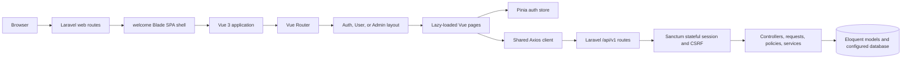

# Planora

**Plan your day. Shape your future.**

Planora is a Laravel and Vue single-page application for personal productivity, with an administration area for managing accounts and monitoring platform tasks. Authentication, user administration, and database-backed User and Admin task workflows are implemented. Project, category, calendar, and related productivity screens remain partial or scaffolded.

This README describes the implementation in this repository. Features listed as planned or scaffolded below should not be treated as available product functionality.

## Project Overview

Planora brings sign-in, a personal workspace, account administration, and task management together in one web application. Users can create and manage their own tasks, view tasks assigned to them, and update task status. Administrators can manage platform tasks and user accounts through the Admin Panel. Project and other productivity-data workflows remain incomplete.

### User types

| Role | Current capabilities |
|---|---|
| User | Sign in to an active, verified account; manage owned tasks and view assigned tasks in the personal workspace. |
| Moderator | Has explicitly assigned user-management permissions in the backend. Seeded moderators can view users. The current Vue Admin route guard requires the admin role, so the moderator management UI is not currently accessible end-to-end. |
| Admin | Access the Admin Panel, manage user accounts and tasks across the platform, subject to authorization protections. |

## Features and Implementation Status

### Implemented

- Laravel-backed session login and logout, current-user lookup, Remember Me, and role-aware post-login redirects.
- Registration with server-side validation and a six-digit email verification OTP. In the local development environment, registration is database-only: no email is sent and the developer reads the code from the OTP table. The account is created only after successful verification.
- Password recovery with hashed, expiring email OTPs, resend cooldowns, attempt limits, a short-lived HttpOnly recovery cookie, and single-use password reset. In local development, a fresh code can be issued and displayed with a protected Artisan command instead of email.
- Admin Dashboard account statistics, recent registrations, status distribution, and recorded account activity loaded through the Admin users API.
- Admin Users Management: server-side search, role/status/verification/date filters, sorting, pagination (up to 10 records per page), refresh, and account statistics.
- User Tasks and Admin Tasks: database-backed create, view, update, status changes, and soft deletion; task search, filters, sorting, pagination, assignment, and calculated statistics.
- User Dashboard task statistics and recent tasks loaded from the authenticated User Tasks API.
- User create, view, and edit flows; profile avatar upload/removal; role and moderator-permission management; account status changes; activity records; soft deletion and restore.
- Backend validation, role middleware, policies, moderator permission checks, self-account restrictions, and protection against removing the last active administrator.
- Responsive User, Admin, and Authentication layouts and a shared Planora component/style system.
- A trusted, repeatable development seeder for 20 sample accounts (1 admin, 3 moderators, 16 users).

### Partial or scaffolded

- Projects, categories, calendar, reports, tags, notifications, settings, and several Admin pages are partial or scaffolded; their full persistent workflows are not implemented.
- Email delivery is not used by the local registration flow. Outside the local environment, the registration service attempts to use Laravel Mail; an operational SMTP/provider configuration has not been verified by this project documentation.
- Moderators can be authorized by the backend for limited user management, but the Vue Admin layout is guarded for admins only. This currently prevents moderator access through the SPA.

## Technology Stack

Dependency versions are taken from the checked-in lockfiles. Version constraints are shown where the project declares a range rather than an exact runtime requirement.

| Area | Technology | Project requirement / locked version |
|---|---|---|
| Backend runtime | PHP | `^8.1` |
| Backend framework | Laravel Framework | `^10.10` / `v10.50.4` |
| API authentication | Laravel Sanctum | `^3.3` / `v3.3.3` |
| HTTP client library | Guzzle | `^7.2` / `7.16.1` |
| Database | MySQL | Selected in `.env.example`; configure the version supported by the deployment's Laravel/PHP setup |
| Frontend | Vue | `^3.5.44` / `3.5.44` |
| Routing | Vue Router | `^4.6.4` / `4.6.4` |
| State management | Pinia | `^3.0.4` / `3.0.4` |
| HTTP client | Axios | `^1.6.4` / `1.21.0` |
| Asset build | Vite | `^5.0.0` / `5.4.21` |
| Vue integration | `@vitejs/plugin-vue` | `^6.0.10` / `6.0.10` |
| Laravel/Vite integration | `laravel-vite-plugin` | `^1.0.0` / `1.3.0` |

The Vue Vite plugin declares Node.js `^20.19.0` or `>=22.12.0`; use a compatible Node.js release and npm. Bootstrap and a third-party UI component framework are not listed dependencies; the application uses its own Vue components and CSS.

## Architecture

### Request and rendering flow

### Backend

- `routes/web.php` serves the SPA shell and applies session, active-account, role, and management-access middleware to application paths.
- `routes/api.php` mounts the versioned routes in `routes/api/v1.php` under `/api/v1`.
- The API uses Sanctum's stateful SPA middleware. The frontend initializes the CSRF cookie, sends same-origin cookies and XSRF data, and calls the versioned API.
- Authentication, user-management, and task operations are organized into API controllers, Form Requests, JSON Resources, Eloquent models, policies/middleware, and services under `app/`.
- Admin user listing and statistics use `UserManagementQueryService`; mutation and audit behavior is in `UserManagementService` and `UserActivityLogger`.
- Admin and User task listing, filtering, sorting, pagination, and statistics use `TaskService` and `UserTaskService`; User task queries are scoped to owned or assigned records.
- There are no separate Role or Permission database models. Roles are values on `users.role`; moderator permissions are stored as JSON on the user and constrained by `config/user_management.php`.

The registered API surface includes authentication, account administration, and task management:

| Method | Endpoint | Purpose / access |
|---|---|---|
| `POST` | `/api/v1/auth/login` | Session login; 10 requests/minute |
| `POST` | `/api/v1/auth/register` | Start pending registration; 5 requests/minute |
| `POST` | `/api/v1/auth/register/verify` | Verify OTP and create/sign in the user; 10 requests/minute |
| `POST` | `/api/v1/auth/register/resend` | Replace pending OTP; 3 requests/minute |
| `POST` | `/api/v1/auth/password/forgot` | Request a password recovery code; generic response avoids account enumeration |
| `POST` | `/api/v1/auth/password/resend` | Resend a recovery code subject to cooldown and throttling |
| `POST` | `/api/v1/auth/password/verify` | Verify recovery OTP and issue a short-lived HttpOnly recovery cookie |
| `POST` | `/api/v1/auth/password/reset` | Reset password using the verified recovery session |
| `POST` | `/api/v1/auth/logout` | Authenticated logout |
| `GET` | `/api/v1/user` | Current active authenticated user |
| `GET` | `/api/v1/admin/users` | Authorized user list, filters, pagination, and statistics |
| `POST` | `/api/v1/admin/users` | Admin-only user creation |
| `GET` | `/api/v1/admin/users/{user}` | Authorized user details and permitted activity |
| `PATCH` | `/api/v1/admin/users/{user}` | Admin-only profile update |
| `POST` | `/api/v1/admin/users/{user}/password` | Admin changes their own password after current-password validation |
| `DELETE` | `/api/v1/admin/users/{user}` | Authorized soft delete (admin only) |
| `POST` | `/api/v1/admin/users/{userId}/restore` | Restore an authorized soft-deleted account |
| `PATCH` | `/api/v1/admin/users/{user}/role` | Admin-only role change |
| `PATCH` | `/api/v1/admin/users/{user}/status` | Admin or specifically permitted moderator status change |
| `PUT` | `/api/v1/admin/users/{user}/permissions` | Admin-only moderator permission update |
| `GET` | `/api/v1/admin/users/activity` | Authorized user activity listing |
| `GET` | `/api/v1/admin/users/roles-permissions` | View role/permission definitions |
| `GET` | `/api/v1/admin/tasks` | Admin task listing, search/filters, sorting, pagination, and global statistics |
| `GET` | `/api/v1/admin/tasks/assignees` | Admin task owner/assignee choices |
| `POST` | `/api/v1/admin/tasks` | Admin task creation |
| `GET` | `/api/v1/admin/tasks/{task}` | Admin task details |
| `PATCH` | `/api/v1/admin/tasks/{task}` | Admin task and assignment update |
| `DELETE` | `/api/v1/admin/tasks/{task}` | Admin soft deletion |
| `GET` | `/api/v1/tasks` | Authenticated user's owned/assigned tasks, filters, sorting, pagination, and statistics |
| `POST` | `/api/v1/tasks` | Create a task owned by the authenticated user |
| `GET` | `/api/v1/tasks/{task}` | View an owned or assigned task |
| `PATCH` | `/api/v1/tasks/{task}` | Update an owned task |
| `PATCH` | `/api/v1/tasks/{task}/status` | Update status of an owned or assigned task |
| `DELETE` | `/api/v1/tasks/{task}` | Soft-delete an owned task |

Other controller and request files in the repository do not imply that their domain APIs are registered. The route list is the source of truth for the active API surface.

### Frontend

- `resources/views/welcome.blade.php` is the SPA entry point; Vite loads `resources/css/app.css` and `resources/js/app.js`.
- `resources/js/app.js` mounts Vue, Pinia, and Vue Router. Route pages are lazy-loaded from `resources/js/router/routes.js`; `guards.js` checks session identity and roles for routes marked protected.
- Authentication state and requests live in `resources/js/features/auth/`. The shared Axios client is `resources/js/shared/services/api.js`.
- Feature-specific UI and API helpers are organized under `resources/js/features/`; shared controls and layout components are under `resources/js/shared/`.
- Task features are separated into `resources/js/features/tasks/user/` and `resources/js/features/tasks/admin/`, each with components and API services; User task state and Admin list state live in their respective composables.
- Styles are split into CSS variables/base styles, shared components/layouts, and feature/page styles under `resources/css/`.

### Important project directories

| Path | Purpose |
|---|---|
| `app/Http/Controllers` | Web/API request handlers |
| `app/Http/Requests` | Server-side request validation and authorization |
| `app/Http/Resources` | API response serialization |
| `app/Models` | Eloquent models for users, tasks, registrations, activity, and other domains |
| `app/Policies`, `app/Http/Middleware` | Authorization and request access controls |
| `app/Services` | Registration, dashboard, user-management, and task operations |
| `database/migrations` | Database schema history |
| `database/seeders` | Local development fixtures |
| `resources/js/pages` | Vue route pages for Admin, User, Auth, and errors |
| `resources/js/features` | Feature components, stores, and API helpers |
| `resources/js/router` | Vue Router records and guards |
| `resources/css` | Application, layout, component, and page styles |
| `routes` | Laravel web, API, and console route definitions |
| `tests/Feature`, `tests/Unit` | PHPUnit feature and unit tests |
| `docs` | Supporting API, architecture, database, security, and OTP notes |

## Authentication and Authorization

### Login and sessions

- Laravel's default `web` guard uses the session driver and Eloquent `User` provider. The SPA uses Sanctum's stateful cookie authentication; it does not issue a custom Remember Me token.
- Login validates email/password and optional `remember`, requires an allowed role, active account status, and verified email, updates `last_login_at`, records activity, and regenerates the session.
- Remember Me passes the checkbox value to Laravel's `attempt` call. The configured persistent remember lifetime defaults to 43,200 minutes (30 days); the regular session lifetime defaults to 120 minutes. Logout invalidates the session and Laravel remember token.
- Login redirects admins to `/admin/dashboard`, users to `/dashboard`, and moderators to the management area allowed by their assigned permission. The current Vue guard's admin-only layout means moderator UI access is incomplete, as noted above.
- Workspace paths require an authenticated active account and an accepted role. The Admin users paths also require management access. API operations use `auth:sanctum`, active-account middleware, role checks, and policies/requests as appropriate.

### Registration and passwords

- Public registration accepts a name, email, password, and password confirmation. The backend normalizes the email, checks uniqueness, prohibits a client-supplied role, and applies the `NotCommonRegistrationPassword` rule.
- Self-registration passwords must be 8–128 characters and match confirmation. Common and predictable patterns are rejected; uppercase, digits, and symbols are not individually mandatory. The User model hashes password assignments, and registration stores only a hash in its pending record.
- After successful OTP verification, the account receives the `user` role, active status, and a verified email timestamp. Public registration cannot select admin or moderator.
- Admin-created accounts have stricter server-side password rules (minimum 12 characters, mixed case, and numbers) and can be assigned one of the supported roles.

### Roles, permissions, and account status

Supported roles are `admin`, `moderator`, and `user`. Supported account statuses are `active`, `inactive`, `suspended`, and `banned`.

- Admins have full user-management permission. Moderators receive explicitly assigned permissions such as viewing users, viewing allowed activity, and managing non-admin user statuses. Users have no administrative permissions.
- Admin policies restrict create/update/delete and sensitive operations. Self role/status changes and self deletion are blocked. The service serializes critical admin changes and prevents the last active admin from being demoted, deactivated, suspended, banned, or deleted.
- Suspended, banned, and inactive users are blocked from protected web/API areas by active-account middleware. Admin user deletion is soft deletion; an authorized restore operation returns the account to active status.
- Vue navigation guards improve navigation UX but are not a security boundary. Backend middleware, authorization, validation, and policies enforce access to APIs.

## Email OTP Verification — Local Development

The local registration workflow is database-only so a developer can verify registration without configuring SMTP:

1. Registration validates the submitted details and checks the email against `users`.
2. A six-digit code is generated. Registration data is saved separately in `pending_registrations`; its password is Laravel-hashed.
3. An OTP record is stored in `email_verification_otps`. The OTP hash is stored in all environments. When `APP_ENV=local`, the same row also has the readable development-only value in `otp_code`.
4. No SMTP, Gmail, or other mail transport is called in the local environment. The verification page explains where to find the local code; the API does not return the code.
5. A correct, unexpired OTP creates the verified `user` account inside a database transaction, then removes the OTP and pending-registration rows and logs the user in. A wrong, expired, exhausted, or reused OTP does not create an account.

Current limits in `RegistrationService`: OTP lifetime is 5 minutes, maximum incorrect attempts are 5, and resend cooldown is 60 seconds. Login, registration, verify, and resend routes also have per-minute throttles. Resending replaces the stored hash/code, invalidating the prior code. Pending registrations expire after 24 hours.

For local development, inspect the code in MySQL/phpMyAdmin:

~~~sql
SELECT email, otp_code, expires_at, attempts, last_sent_at
FROM email_verification_otps
WHERE email = 'your-registration-email@example.com';
~~~

Outside `local`, the code field is null and only the hash remains in the OTP table; the service attempts delivery through the configured Laravel Mail transport. The checked-in `.env.example` uses Mailpit defaults and does not provide real SMTP credentials. Production delivery therefore requires the deployment operator to configure and verify an appropriate mail provider. Never enable readable OTP storage outside local development or publish OTP values.

Expired pending registration and OTP data are purged by `auth:purge-expired-registrations`, scheduled every five minutes. The application host must run Laravel's scheduler (see [Registration OTP notes](docs/REGISTRATION_OTP.md)).

## Admin Panel and User Management

The Vue Admin Dashboard loads its figures and recent activity from the protected Admin users and activity APIs; these are database-backed rather than fixed demo values. It displays total, active, suspended, and administrator counts, account-status distribution, recent registrations, and recorded activity.

The Users Management screen supports:

- Paginated user listing with a maximum of 10 records per page, search by name/email, role/status/verification/date filters, and supported sort modes.
- Total, active, inactive, suspended, banned, and recent ordinary-user registration statistics. The “new users” calculation uses `created_at` within the preceding 30 days and only role `user`; normal Eloquent soft-delete scoping excludes deleted accounts.
- User creation, details viewing, and editing. The form supports names, email, optional username/phone/avatar, account role/status at creation, and moderator permissions where applicable.
- Role and status changes, moderation reasons for suspended/banned states, and activity history where permitted.
- Soft delete and restore. The backend enforces policy checks, self-account restrictions, and last-active-admin protection.

The Admin Vue route includes the Users Index and Create page; View and Edit are presented in the Index page's modal flows. Moderator permissions exist in the backend, but the Vue Admin layout currently requires the admin role, so moderators cannot use the management interface through the current SPA routing.

## Database and Seeders

Configure the database through `.env`; `.env.example` selects MySQL. The checked-in migrations define these main tables:

| Table | Purpose |
|---|---|
| `users` | Account profile, unique email/username, verified timestamp, password hash, role/status, moderator permission JSON, status-change metadata, phone/avatar, last login, remember token, timestamps, and soft-delete timestamp |
| `email_verification_otps` | Per-email OTP hash, local-only readable code, expiry, attempt count, resend timestamp |
| `pending_registrations` | Temporary name/email/password hash and 24-hour expiry, separate from real user accounts |
| `user_activity_logs` | Account event, description, optional JSON context, affected user and actor references |
| `password_reset_otps` | Hashed password recovery OTP, expiry, attempt count, verification state, and recovery-token data |
| `password_reset_tokens` | Legacy Laravel password-reset token storage schema; the current recovery flow uses `password_reset_otps` and a short-lived recovery cookie |
| `tasks` | Task title and description, status, priority, optional due date, owner, assignee, creator, timestamps, soft deletion, and filtering indexes |
| `personal_access_tokens` | Sanctum token table; current SPA authentication uses stateful sessions |
| `failed_jobs` | Laravel failed queue jobs |

The task table is defined by a database migration and is used by the User and Admin task APIs. There are no migrations defining project, category, subtask, tag, calendar-event, or notification data tables; corresponding screens remain partial or scaffolded.

### Seeded local accounts

`DatabaseSeeder` calls `PlanoraUsersSeeder`, which defines 20 local test accounts: 1 admin, 3 moderators, and 16 regular users. Newly created fixtures have verified email and the same demo password. The seeder is idempotent by email: it creates missing fixture accounts and, for an existing matching email, only fills `email_verified_at` if it is null; it does not overwrite the existing account's password, role, or profile. Moderator fixtures are assigned `users.view`.

Task demo records are seeded separately with `php artisan db:seed --class="Database\Seeders\UserTasksDemoSeeder"`. This idempotent local-development seeder creates five identifiable demo tasks per eligible existing regular user without deleting existing records or running as part of `migrate --seed`. It does not create categories. Review `database/seeders/UserTasksDemoSeeder.php` before using it with a non-development database.

| Name | Email | Role |
|---|---|---|
| Admin | `admin@gmail.com` | admin |
| Moderator One | `moderator1@gmail.com` | moderator |
| Moderator Two | `moderator2@gmail.com` | moderator |
| Moderator Three | `moderator3@gmail.com` | moderator |
| User One | `user1@gmail.com` | user |
| User Two | `user2@gmail.com` | user |
| User Three | `user3@gmail.com` | user |
| User Four | `user4@gmail.com` | user |
| User Five | `user5@gmail.com` | user |
| User Six | `user6@gmail.com` | user |
| User Seven | `user7@gmail.com` | user |
| User Eight | `user8@gmail.com` | user |
| User Nine | `user9@gmail.com` | user |
| User Ten | `user10@gmail.com` | user |
| User Eleven | `user11@gmail.com` | user |
| User Twelve | `user12@gmail.com` | user |
| User Thirteen | `user13@gmail.com` | user |
| User Fourteen | `user14@gmail.com` | user |
| User Fifteen | `user15@gmail.com` | user |
| User Sixteen | `user16@gmail.com` | user |

The password for newly created fixtures is `password`. These are public, local-only demo credentials, not secure credentials. Do not use them in a deployed environment. If an account with a fixture email already exists, the seeder preserves its existing password and role; inspect that row if the local account no longer matches the fixture credentials. The seeder does not truncate tables or remove other accounts.

## Requirements

- PHP 8.1+ satisfying the Composer constraint and required Laravel PHP extensions.
- Composer.
- Node.js `^20.19.0` or `>=22.12.0` and npm, as required by the locked Vue/Vite plugin toolchain.
- MySQL and a database created for the application.

## Installation and Setup

From a terminal with the prerequisites installed:

~~~sh
git clone https://github.com/ElmirVelizadeDev/Planora.git
cd Planora
composer install
npm ci
~~~

Create a local environment file:

~~~sh
# macOS / Linux
cp .env.example .env
~~~

~~~powershell
# Windows PowerShell
Copy-Item .env.example .env
~~~

Edit `.env` and set the local app URL and database name/user/password. Create the database in MySQL first, then initialize the app and apply the schema plus local fixtures:

~~~sh
php artisan key:generate
php artisan migrate --seed
php artisan storage:link
~~~

`migrate --seed` applies outstanding migrations and runs the idempotent Planora user fixture seeder; it does not run the separate task demo seeder or reset existing tables. Do not use `migrate:fresh` on a database with data because that command drops tables. `storage:link` enables public access to uploaded user avatars on the configured public disk.

Run the Laravel server and Vite in separate terminals:

~~~sh
php artisan serve
~~~

~~~sh
npm run dev
~~~

Open the URL printed by `php artisan serve` (normally `http://127.0.0.1:8000`). Set `APP_ENV=local` for the database-readable, no-email OTP development behavior described above. Local demo accounts can be used to explore role-specific pages.

## Environment Configuration

Use [`.env.example`](.env.example) as the starting point. The minimum local setup includes:

- `APP_ENV`, `APP_KEY`, `APP_URL`, and `APP_DEBUG`.
- `DB_CONNECTION`, `DB_HOST`, `DB_PORT`, `DB_DATABASE`, `DB_USERNAME`, and `DB_PASSWORD`.
- Session/cookie settings. The example uses a 120-minute session and sets `SESSION_REMEMBER_LIFETIME=43200`; set `SESSION_SECURE_COOKIE=true` when serving over HTTPS.
- Mail settings only when using the non-local registration mail path. The local database-only flow does not require SMTP.

The shared Axios client defaults to `/api/v1`; `VITE_API_BASE_URL` can override the API base URL. If the frontend uses a separate origin or a custom domain, review Sanctum stateful domains, CORS, session domain, and CSRF setup in `config/sanctum.php`, `config/cors.php`, and `config/session.php`.

Keep `.env` local. Do not commit application keys, database credentials, mail credentials, or OTP values.

## Development Workflow

| Command | Purpose |
|---|---|
| `php artisan serve` | Start Laravel's local web server |
| `npm run dev` | Start Vite with hot reload |
| `npm run build` | Build production assets into `public/build` |
| `php artisan migrate` | Apply outstanding migrations |
| `php artisan migrate --seed` | Apply migrations and run the idempotent Planora user fixtures |
| `php artisan db:seed --class=PlanoraUsersSeeder` | Run only the Planora fixture seeder |
| `php artisan db:seed --class="Database\Seeders\UserTasksDemoSeeder"` | Add the separate idempotent User task demo fixtures (development only) |
| `php artisan route:list` | Inspect registered Laravel routes |
| `php artisan migrate:status` | Inspect migration state |
| `php artisan optimize:clear` | Clear Laravel's cached config/routes/views/events |
| `php artisan test` | Run the PHPUnit suite |
| `php artisan auth:purge-expired-registrations` | Manually purge expired unverified registrations and OTPs |
| `php artisan schedule:work` | Run the Laravel scheduler in a foreground development process |

## Testing and Validation

Backend tests are in `tests/Feature` and `tests/Unit`; they cover authentication and password recovery, Admin user management, and User/Admin task workflows. Run them with `php artisan test`. Feature tests expect the configured test database to be available; `phpunit.xml` does not enable an in-memory SQLite database by default, so configure a safe, isolated test database before running them.

There is no JavaScript test script in `package.json`. Validate frontend compilation with `npm run build`. For a documentation-only or code change review, `git diff --check` catches whitespace errors.

## Security and Development Notes

- Passwords are hashed by Laravel; user resources hide the password and remember token.
- Registration OTP hashes are stored in the OTP table. Only local development also stores a readable `otp_code`; it is hidden from model serialization and never returned from registration APIs. Keep `APP_ENV` correct and do not expose the local database publicly.
- Password recovery uses hashed OTPs, expiry, attempt and resend limits, a short-lived HttpOnly recovery cookie, and a single-use reset flow. In local development, issue and display a fresh code with `php artisan auth:local-otp recovery <email>`; outside local, configure and verify mail delivery.
- Registration pending data, including the password hash, is held outside `users`. The transaction creates a verified user only after valid OTP confirmation.
- Rate limits are applied to login, registration, verification, resend, and password recovery endpoints. Server-side Form Requests, middleware, policies, and service checks are required even when the Vue router also guards pages.
- Laravel stateful cookies and CSRF protection are used for SPA requests. Use HTTPS and secure cookie settings in deployments.
- Role/status changes and destructive account actions must use the protected backend endpoints; client-side controls alone are not authorization.
- Avatar uploads are validated as JPG/JPEG/PNG/WebP, dimension-limited to 4096×4096, and limited to 2 MB by the user-management requests. The public storage symlink is needed to serve saved files.
- The development seeder password is intentionally simple and shared. Do not seed these accounts into production.
- In the non-local environment, OTP delivery depends on configured Laravel Mail transport. The checked-in example targets Mailpit; configure a real provider and validate delivery separately before relying on it.

## Current Development Status

### Working foundation

- Laravel 10 and Vue 3 are integrated through Vite and the Blade SPA shell.
- Session/Sanctum authentication, role/status enforcement, Remember Me, local database OTP registration, and registration cleanup scheduling are implemented.
- Admin user listing/management endpoints, policy checks, account activity logging, dashboard account statistics, and user fixtures are implemented.
- User/Admin task CRUD, task authorization and user scoping, dashboard task statistics, and task demo fixtures are implemented.
- Responsive shared layouts and user/admin/auth page styling are present.

### In progress / incomplete

- Project, category, calendar, and related productivity pages remain partial or scaffolded; persistent workflows are not implemented for those modules.
- Several Admin navigation destinations (roles, projects, categories, tags, reports, notifications, settings, and activity detail) remain partial or scaffolded. User management, user activity APIs, and task management are implemented.
- Moderator management authorization exists in backend code but is mismatched with the admin-only Vue route guard.
- Public email delivery requires a separately configured and tested provider outside the local development path.

## Roadmap

The repository's current development priorities are to complete productivity data models and APIs, connect User Dashboard and feature pages to persisted operations, reconcile moderator UI access with its backend permissions, implement password recovery, and expand automated test coverage. These are incomplete areas, not features claimed as available today.

## Documentation

- [Registration OTP lifecycle and scheduler setup](docs/REGISTRATION_OTP.md)
- Additional documentation files under `docs/` include API, architecture, security, database, and roadmap materials; some are still documentation scaffolds.

## License

`composer.json` declares the project license as MIT. A separate root `LICENSE` file is not currently present.

## Author

**Elmir Velizade** · [GitHub](https://github.com/ElmirVelizadeDev)
