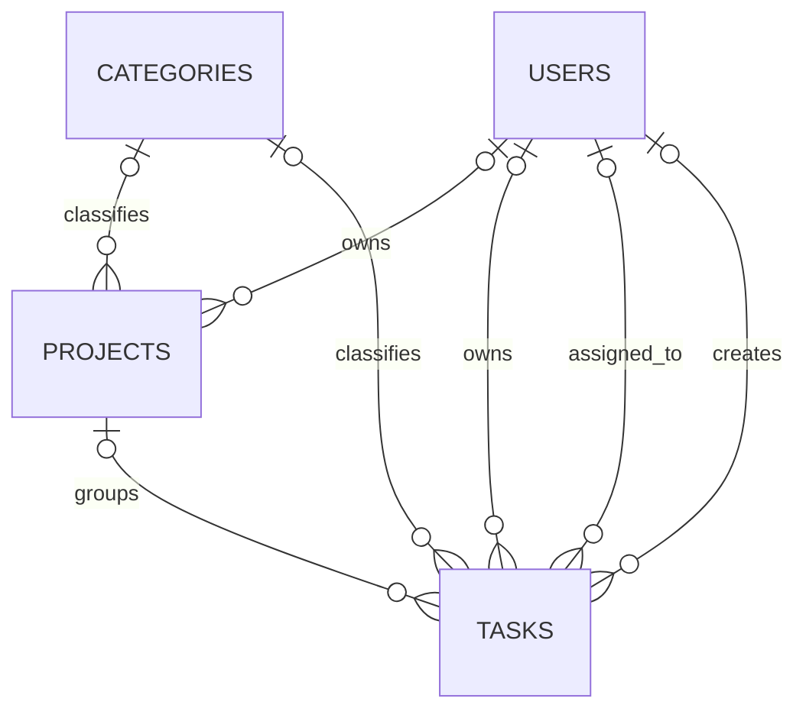

# Database Design

Laravel database settings come from the environment; `.env.example` selects MySQL. Schema changes are tracked in `database/migrations/`. Feature tests use an isolated MySQL database described in [Testing Database](TESTING_DATABASE.md).

## Core tables

| Table | Purpose |
|---|---|
| `users` | Accounts, profile, role/status, verification, password hash, login metadata, and soft deletion. |
| `projects` | Project name and description, lifecycle status, optional dates, nullable User owner, optional Category, and timestamps. |
| `tasks` | Task content, status, priority, optional due date, optional Project and Category, owner, assignee, creator, timestamps, and soft deletion. |
| `categories` | Category name, optional description, display color, timestamps, and soft deletion. |
| `user_activity_logs` | Immutable account, authentication, and business activity with actor/subject snapshots, safe change values, request context, result status, and filter indexes. |
| `pending_registrations` | Temporary registration details and password hash retained until verification or expiry. |
| `email_verification_otps` | Registration OTP hash, expiry, attempt count, and resend timestamp. Plaintext codes are not stored. |
| `password_reset_otps` | Password-recovery OTP hash, expiry, verification, attempt, and recovery-token state. |
| `password_reset_tokens` | Legacy Laravel password-reset token table; current recovery uses `password_reset_otps`. |
| `personal_access_tokens` | Sanctum token storage; the first-party SPA uses stateful sessions. |
| `failed_jobs` | Laravel failed queue records. |

## Project, Task, and Category relationships

- A Category has many Projects and Tasks. Each Project and Task has one optional Category through a nullable `category_id` foreign key.
- Categories use soft deletion for archiving. Project and Task relationships load archived Categories for historical display. Archiving does not delete or detach related records; restoring makes the Category active again.
- The Category foreign keys use restrictive delete behavior. The API provides archive and restore operations, not permanent Category deletion. A referenced Category cannot be permanently deleted without first resolving its associations.
- Projects are not soft-deleted. Deleting a Project sets linked Tasks' nullable `project_id` to null, preserving those Tasks.
- `projects.owner_id` is nullable and becomes null when its User is deleted. Task owner, assignee, and creator are User references. Tasks are soft-deleted.
- User Project queries are restricted to Projects owned by the authenticated User. User-visible Tasks are restricted to Tasks owned by or assigned to that User; category detail counts and related records apply the same scopes.
- Admin category usage counts are global. Project counts include related Projects; Task counts follow the Task model's normal soft-delete scope.

## Migrations and demo data

The Project schema is created by `2026_11_11_000001_create_projects_table.php`; the nullable Task-to-Project relationship is added by `2026_11_11_000002_add_project_id_to_tasks_table.php`. Categories are created by `2026_11_12_000001_create_categories_table.php`; nullable Category foreign keys on Projects and Tasks are added by `2026_11_13_000001_add_category_id_to_projects_and_tasks_tables.php`. Earlier migrations create account, authentication, activity, and Task tables.

`DatabaseSeeder` always invokes `PlanoraUsersSeeder`; it invokes Category, Project, and User Task demo seeders only under `APP_ENV=local`. The three demo seeders are individually guarded for local use. Because the account seeder is not guarded, do not run `db:seed` or `migrate --seed` outside a disposable local database. See [Seeder Notes](../database/seeders/README.md).

The ten CategorySeeder names are inserted only when no case-insensitive active or archived name match exists. Existing Categories are not updated. Project and Task demo seeders create marked records for active normal Users; they preserve an existing non-null category association, including an archived Category, and only fill an absent association from a matching active Category. They do not rewrite unrelated records.

The Activity Logs audit-trail migration extends the existing `user_activity_logs` table rather than introducing a duplicate log table. New fields are nullable where necessary so historical rows remain valid. Actor and legacy subject foreign keys use null-on-delete, while safe name/role snapshots, subject labels, and event metadata retain useful history. Activity rows are not soft-deleted or editable through application endpoints. Search/filter indexes cover module, event, status, actor, target, and creation time.

Subtask, tag, calendar-event, and notification tables are not defined by the current migrations; their routes or components do not imply persisted workflows.
