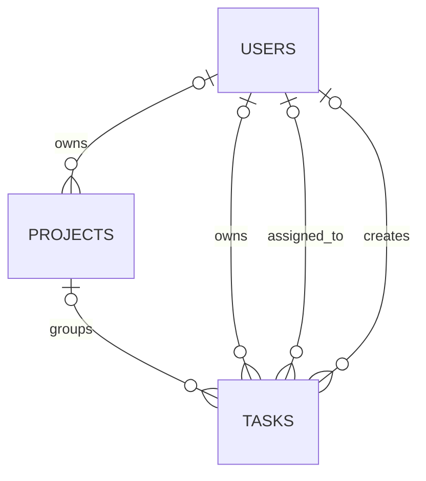

# Database Design

Database configuration comes from the Laravel environment; `.env.example` selects MySQL. Schema changes are tracked in `database/migrations/`. Feature tests use a separately configured MySQL database (see [Testing Database](TESTING_DATABASE.md)).

## Core tables

| Table | Purpose |
|---|---|
| `users` | Accounts, role and status, profile data, verification, password hash, login metadata, and soft deletion. |
| `projects` | Project name/description, lifecycle status, optional start/due dates, and nullable owner reference. |
| `tasks` | Task title/description, status, priority, due date, Project reference, owner, optional assignee, creator, and soft deletion. |
| `user_activity_logs` | Recorded user-management and authentication activity with optional context and actor/subject references. |
| `pending_registrations` | Temporary registration data and password hash retained until email verification or expiry. |
| `email_verification_otps` | Hashed registration code, expiry, attempt count, and resend timestamp; local development also stores the readable development code. |
| `password_reset_otps` | Hashed password-recovery code and associated expiry, verification, attempt, and recovery-token state. |
| `password_reset_tokens` | Laravel's legacy password reset token table; the current recovery workflow uses `password_reset_otps`. |
| `personal_access_tokens` | Sanctum token storage; the first-party SPA uses stateful sessions. |
| `failed_jobs` | Laravel failed queue job records. |

## Project and Task relationships

- `projects.owner_id` references `users.id` and is nullable; deleting an owner sets the reference to null.
- `tasks.project_id` references `projects.id` and is nullable; deleting a Project sets the Task's `project_id` to null, preserving the Task.
- Task owner, assignee, and creator are User references. Tasks are soft-deleted; Projects are not soft-deleted.
- User Project API queries are limited to Projects owned by the authenticated User. Project Task queries additionally include only Tasks owned by or assigned to that User.

## Schema changes and demo data

The Project schema is added by `2026_11_11_000001_create_projects_table.php`; the nullable Task relationship and index are added by `2026_11_11_000002_add_project_id_to_tasks_table.php`. Earlier migrations create the account, authentication, activity, and Task tables.

In `APP_ENV=local`, `DatabaseSeeder` invokes the User, Project, and User Task demo seeders. The Project seeder generates marked Projects and linked Tasks; the User Task seeder generates standalone Tasks. These seeders are idempotent and do not truncate or remove unrelated rows. See [database seeder notes](../database/seeders/README.md).

Category, subtask, tag, calendar-event, and notification tables are not defined by the current migrations; their presence in frontend routes does not imply a persisted data model.
